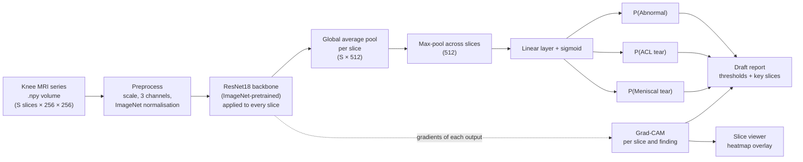

# CartilAI

**AI-assisted knee MRI analysis.**

> ⚠️ **Research prototype — not for clinical use.** CartilAI estimates how likely it is that certain findings are *already present* on a knee MRI. It does not predict future injury risk and must not be used to make medical decisions.

CartilAI reads a knee MRI series and returns:

- a **probability for each finding**: *Abnormal*, *ACL tear*, *Meniscal tear*;
- **Grad-CAM heatmaps** over the MRI slices showing which regions drove each score;
- a **slice viewer** to scroll through the volume with the heatmap overlay;
- an auto-generated **draft radiology-style report** with the findings, confidence and key slices.

It follows the approach of Stanford's MRNet paper (Bien et al., *PLOS Medicine*, 2018) with a ResNet18 backbone, trained on the public MRNet dataset in a free Kaggle GPU notebook.

---

## The problem

Knee MRI is the most common musculoskeletal MRI exam. Each exam has hundreds of images across several planes, and reading them is slow and requires subspecialty expertise. A model that flags likely ACL and meniscal tears, and *shows where it is looking*, could help radiologists prioritise worklists and double-check reads. CartilAI is a small, transparent prototype of that idea built for learning and demonstration.

## Architecture



| Part | File | What it does |
|---|---|---|
| Data | `src/data.py` | Finds MRNet on disk, reads labels, normalises volumes, MRNet-style augmentation (rotation, shift, flip) |
| Model | `src/model.py` | ResNet18 per slice → average pool → max over slices → 3 logits |
| Training | `src/train.py` | Class-weighted BCE loss, Adam + one-cycle LR, mixed precision, time budget, best-epoch selection, exports |
| Evaluation | `src/evaluate.py` | AUC with bootstrap 95% CIs, Youden thresholds, sensitivity/specificity, ROC curves, confusion matrices |
| Explainability | `src/gradcam.py` | Grad-CAM on the last convolutional block for every slice; slice-importance scores; overlays |
| Report | `src/report.py` | Template-based draft report (no language model, so nothing is invented) |
| App | `app.py` | Gradio web app: samples, upload, viewer, report, "About the model" tab |
| Synthetic data | `src/synthetic.py` | Cartoon knee volumes in MRNet format for tests and the demo |
| Kaggle notebook | `notebooks/cartilai_kaggle_training.ipynb` | Self-contained training run, generated from `src/` by `scripts/build_notebook.py` |
| Config | `config.yaml` | All settings (seed, paths, hyper-parameters) in one place |

**Key design choices**

- **2D CNN per slice + max-pool (MRNet):** pretrained 2D networks transfer well from ImageNet, need far less data and GPU than 3D CNNs, and max-pooling lets one clearly abnormal slice drive the exam-level score.
- **One model, three outputs:** a shared backbone learns features useful for all three findings; independent sigmoids allow several findings at once.
- **Sagittal plane first:** ACL and menisci are best seen on sagittal images; the MRNet paper's per-plane models were strongest there for ACL.
- **Honest evaluation:** the best epoch and decision thresholds are picked on a 10% split of MRNet *train*; the official MRNet *validation* set (120 exams) is used once, as an untouched test set.

## Results

<!-- RESULTS:START -->
_Pending: these numbers are filled in automatically from `results/metrics.json` after the Kaggle training run (see [KAGGLE_STEPS.md](KAGGLE_STEPS.md))._

| Finding | AUC (95% CI) | Sensitivity | Specificity | Accuracy |
|---|---|---|---|---|
| Abnormal | pending | pending | pending | pending |
| ACL tear | pending | pending | pending | pending |
| Meniscal tear | pending | pending | pending | pending |
<!-- RESULTS:END -->

For reference, the original MRNet paper reported AUCs of 0.937 (abnormal), 0.965 (ACL) and 0.847 (meniscus) by combining three planes; a single-plane model is expected to score somewhat lower.

## How to run

### 1. Launch the app (one command)

You need Python 3.10 or newer. From the project folder:

```bash
python start.py
```

The first run creates a private environment in `.venv` and installs the dependencies (a few minutes); later runs start in seconds. The app opens at <http://127.0.0.1:7860>. It works straight away in **demo mode** with four bundled synthetic scans; click a sample and **Analyze**.

Already have the dependencies? `pip install -r requirements.txt && python app.py` does the same.

### 2. Train the real model on Kaggle

Follow [KAGGLE_STEPS.md](KAGGLE_STEPS.md). In short: upload `notebooks/cartilai_kaggle_training.ipynb` to Kaggle, attach the [**MRNet v1** dataset (`cjinny/mrnet-v1`)](https://www.kaggle.com/datasets/cjinny/mrnet-v1), turn on a T4 GPU and Internet, and Run All. The notebook finishes in well under two hours and produces `cartilai_outputs.zip`.

### 3. Switch to the trained model

Put `cartilai_outputs.zip` in the project folder (next to `app.py`) and run `python start.py` again. It installs:

| File from the zip | Goes to | Used for |
|---|---|---|
| `models/cartilai_resnet18.pt` | `models/` | Trained weights and decision thresholds; the app switches out of demo mode automatically |
| `results/metrics.json`, `*.png`, `predictions.csv` | `results/` | "About the model" tab and the results table above |
| `samples/mrnet/*.npy`, `samples.json` | `samples/mrnet/` | Real held-out MRNet exams in the demo gallery |

(You can also unzip it yourself and copy those three folders in, or run `python -m src.install_outputs path/to/cartilai_outputs.zip`.)

### Development

```bash
pip install -r requirements-dev.txt
pytest                                       # 39 tests, ~2 minutes on CPU
python -m src.train --synthetic --quick      # whole training pipeline on synthetic data
python scripts/build_notebook.py             # regenerate the Kaggle notebook after editing src/
```

The tests cover data loading, the model, Grad-CAM, the report, metrics, the full training pipeline, installing Kaggle outputs, the app logic, and executing the Kaggle notebook top to bottom on synthetic data.

## Limitations

- **Not validated for clinical use.** No regulatory review, no prospective testing, no radiologist reader study.
- **One dataset, one hospital.** MRNet has 1,370 exams from Stanford University Medical Center. Performance on other scanners, field strengths, protocols and patient populations is unknown and likely lower.
- **One plane.** Only sagittal images are used. Radiologists read all planes and sequences together.
- **Exam-level labels only.** The model learns from "tear / no tear" per exam, not from outlined lesions, so heatmaps are coarse (8 × 8 grid per slice upsampled) and indicate influence, not lesion boundaries.
- **Small test set.** 120 validation exams give wide confidence intervals, especially for less common findings.
- **Limited label set.** "Abnormal" lumps together many conditions; cartilage lesions, bone bruises and other findings are not reported separately.
- **Synthetic demo data are cartoons.** They exercise the software; they say nothing about real-world accuracy.

## Ethics

- **Human in the loop:** outputs are framed as a *draft* for a qualified radiologist to verify and edit, never as a diagnosis.
- **Detection, not prediction:** CartilAI reports the model's confidence that a finding is present now. It does not estimate anyone's future injury risk.
- **Transparency:** every score comes with a heatmap and the decision threshold, and the "About the model" tab shows held-out performance including confidence intervals.
- **Data use:** MRNet is released by Stanford for non-commercial research under a research use agreement. Exported MRNet scans and trained weights are kept out of version control (`.gitignore`) and should not be redistributed.
- **Bias:** a single-centre dataset may under-represent some populations; any real use would require evaluation across sites and subgroups.

## Future work

- **Dedicated cartilage-lesion detection** — the namesake goal: add cartilage-specific labels (e.g. from the OAI or SKM-TEA datasets) and grade lesions.
- **Other joints** — extend the same pipeline to shoulder (rotator cuff tears) and ankle (ligament injuries) MRI.
- **Multi-plane fusion** — train sagittal, coronal and axial models and combine them, as in the MRNet paper.
- **Segmentation** — pixel-level models (e.g. U-Net) to outline ligaments, menisci and cartilage, for precise localisation and measurements.
- External validation on other hospitals' data, calibration analysis, DICOM input and PACS integration.

## Project structure

```
CartilAI/
├── app.py                     # Gradio web app
├── start.py                   # one-command setup + launch
├── config.yaml                # all settings
├── src/                       # data, model, train, evaluate, gradcam, report, inference, synthetic, install_outputs
├── notebooks/                 # cartilai_kaggle_training.ipynb (generated)
├── scripts/build_notebook.py  # builds the notebook from src/
├── models/                    # trained weights go here (cartilai_resnet18.pt)
├── results/                   # metrics.json, ROC curves, confusion matrices
├── samples/synthetic/         # bundled demo scans (samples/mrnet/ after Kaggle)
├── tests/                     # pytest suite
├── KAGGLE_STEPS.md            # click-by-click training guide
├── INTERVIEW_NOTES.md         # plain-language explanation + interview Q&A
└── DEMO_SCRIPT.md             # 2-minute live demo script
```

## References

- Bien N, Rajpurkar P, et al. *Deep-learning-assisted diagnosis for knee magnetic resonance imaging: Development and retrospective validation of MRNet.* PLOS Medicine 15(11): e1002699 (2018).
- He K, et al. *Deep Residual Learning for Image Recognition.* CVPR 2016.
- Selvaraju RR, et al. *Grad-CAM: Visual Explanations from Deep Networks via Gradient-based Localization.* ICCV 2017.
- MRNet dataset: <https://stanfordmlgroup.github.io/competitions/mrnet/>
